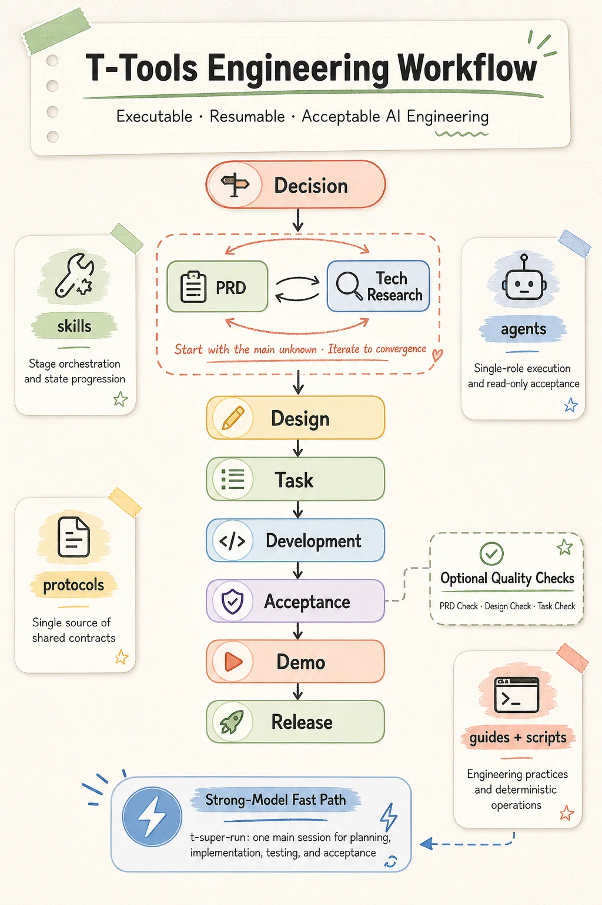

# T-Tools

[中文](README.md)

T-Tools is a Claude Code plugin for Rust, React, Chrome extension, miniapp, Flutter, and Shopify projects. It turns AI programming from "freeform model execution" into an **executable, resumable, and acceptable** engineering workflow:

```text
Decision -> PRD / Tech Research (choose by the main unknown; iterate if needed) -> Design -> Development -> Acceptance -> Demo -> Release
```



## Why T-Tools

- **One command per stage.** Decision, requirements, design, implementation, acceptance, demo, and release each have an explicit entry; artifacts land on disk and state is inspectable.
- **Resumable by design.** Interrupt any stage, rerun the same command, and it continues from the checkpoint — no reliance on session memory.
- **Independent acceptance with evidence.** Acceptance runs read-only subagents under the [acceptance contract](protocols/acceptance-contract.md): required gates must pass; unresolved P0/P1 block delivery.
- **Humans decide, AI executes.** Product trade-offs are confirmed by humans — `t-prd` proactively clarifies choices lacking evidence before writing. AI handles execution, testing, and evidence.
- **Multi-surface coverage.** Web, Chrome extensions, miniapps, Flutter, Shopify, and Figma reconstruction each get dedicated phases and demo acceptance.

To understand how skills, subagents, and protocols work together, read [human/structure.en.md](human/structure.en.md).

## Installation

```bash
git clone <repo-url>
cd /your-project
claude --plugin-dir /path/to/skills
```

Prerequisites:

- MCP Server [`context7`](https://github.com/upstash/context7) is configured
- Configure as needed: Chrome DevTools MCP (`--autoConnect`, for live-extension collaboration, per the [live Chrome debugging guide](guides/extension/live-browser.md)); the official [Figma MCP Server](https://developers.figma.com/docs/figma-mcp-server/) (Figma workflow; asset conversion also needs Python `Pillow`, `ffmpeg`/`ffprobe`, `svgo`, and the [kyz](https://github.com/byteowlz/kyz) credential proxy)
- For tools that do not support `claude --plugin-dir` (Codex, ZCode, etc.), see [Using t-tools in Other AI Coding Tools](human/use-in-other-agents.en.md)

The runtime directories `.ai/` and `docs/` are created automatically during execution. The web/extension demo logging library [`playwright-unified-logger`](https://github.com/timzaak/playwright-unified-logger) is installed by `t-init`.

## Quick Start

Not sure which command to start with? Run `t-how` — it explains the workflow for your goal and recommends the entry command. Minimal loop:

```bash
t-decision user-management      # Decision gate: routes to PRD or tech research by the main unknown
t-prd user-management           # PRD draft (.ai/prd); proactively clarifies key product choices
t-design user-management        # Technical design: master doc + per-stack docs
t-super-run user-management --phase backend   # Implementation + testing + independent acceptance
t-super-run user-management --phase frontend  # Proceed phase by phase; rerun the same command to resume
t-web-demo-run demo/e2e/<role>/<scenario>.e2e.ts   # User-story demo/E2E
t-web-demo-accept <role>                           # Browser user-path acceptance
t-prd-publish user-management   # Publish formal PRD / user stories after acceptance
```

Phase orders: web is `backend -> frontend -> web-demo`; extension is `extension -> extension-demo`; Flutter is `backend -> flutter -> flutter-demo`; Shopify is `shopify-app -> shopify-extension -> web-demo`. See the [phase execution contract](protocols/task-phase-execution.md#phases) for every phase and activation rule.

`t-prd-check`, `t-design-check`, and `t-task-check` are optional quality checks; use them by risk. When plans need separate review or fine-grained item ownership, use `t-task -> t-run` instead of `t-super-run`.

## Capability Map

| What you want to do | Entry |
| --- | --- |
| Product decision, PRD, tech research | `t-decision` / `t-prd` / `t-tech-research`; close out with `t-prd-publish` |
| Design, implementation, acceptance | `t-design`, then `t-super-run <feature> --phase <phase>` |
| User-story demos and acceptance | `t-web-demo-*` / `t-extension-demo-*` / `t-flutter-demo-*` plus the matching `*-accept` |
| Chrome extension projects | Set up a WXT project per the [extension initialization guide](guides/extension/initialization.md), then `--phase extension`; loaded-extension demos via `t-init --extension-demo` |
| Shopify app projects | `t-init --shopify <project-name>`; see the [Shopify development guide](guides/shopify/development.md). `shopify app deploy` runs manually by the user after `t-push` |
| Figma reconstruction | `t-figma-assets` -> `t-figma-impl`: start coding when the human-authored design is about 30% complete — humans confirm scope, AI implements block by block; see the [asset processing guide](guides/figma/assets.md) |
| Commit and quality close-out | `t-review` (reports correctness bugs only) -> `t-simplify` (four-angle cleanup) -> `t-push` ([push execution contract](protocols/push-execution-contract.md)); review / simplify do not replace accept |
| New project scaffold | `t-init <project-name>` (Rust + React full stack; `--shopify` for Shopify) |
| Maintain the plugin and project knowledge | `t-skill` (create/modify skills), `t-doc` (tutorials and docs), `t-dream` (context audit), `t-release` (versioning) |

For every command's parameters, preconditions, and next steps, run `t-how` for an interactive walkthrough.

## Usage Rules

- Every `t-*` command is manually invoked; the model must not trigger them automatically.
- PRD, tech research, and design need explicit human calibration: speak through the real intent with [Do Not Shortcut the Intent](human/speech-template.en.md) first, and never deliver with unconfirmed questions left open.

## Projects Using This Plugin

- [Herald](https://github.com/timzaak/herald) — A multi-tenant authentication and authorization system
- [RMQTT-Things](https://github.com/timzaak/rmqtt-things) — An IoT thing-model management platform built on RMQTT
- [RWiki](https://github.com/timzaak/rwiki) — RAG-powered knowledge base Q&A in a single binary, zero external databases
- [OnceWise](https://github.com/timzaak/OnceWise) — An intelligent form-automation assistant that ends repetitive form filling

> For Java backend support, see the `java` branch.
>
> The `general` branch implements the [generalization plan](human/generalization.en.md): production tech-stack presets are removed in favor of generic project roles that fit any stack, and the extracted domain assets live on as optional exportable templates.

## Learn More

- [human/structure.en.md](human/structure.en.md) — How skills, subagents, and protocols work together
- [protocols/](protocols/) — Shared contracts: phase execution, acceptance, push, and more
- [guides/](guides/) — Domain engineering guides: backend, frontend, extension, Shopify, Figma, and more
- Development log: [linux.do](https://linux.do/t/topic/1988118/4) (in Chinese)
